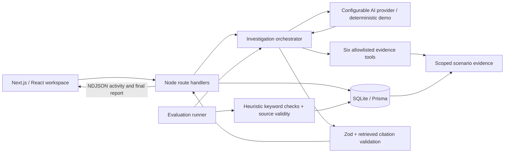
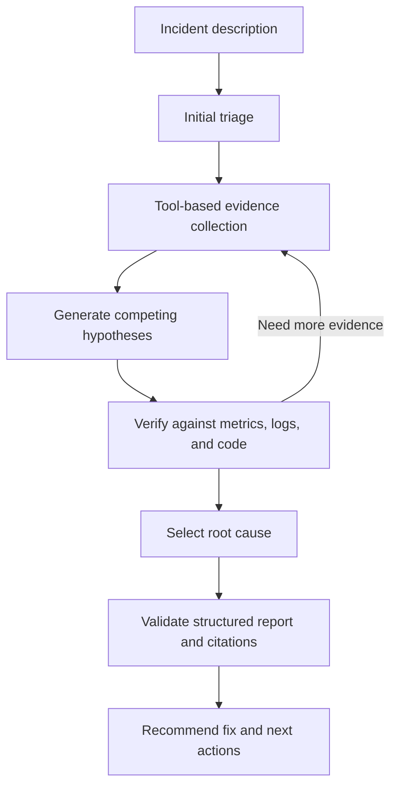

# TraceAI

An AI-powered production incident investigator that connects logs, metrics, deployments, and code to an evidence-backed root-cause report.

## Demo

Open **ShopFlow → Checkout latency regression → Investigate**. Checkout p95 jumps from roughly 320 ms to 3.8 seconds at the v1.42 deployment. The investigator discovers 18 repeated customer lookups in a single request, follows commit `a82f4d`, and identifies a customer query inside the order service's cart-item loop. Payment latency and CPU remain stable.

No account or API key is required. The visible **Demo Mode** badge means a deterministic investigator is executing the same allowlisted evidence tools. It does not call an LLM. Its 87% confidence is illustrative, not a calibrated probability. Add a provider key to run actual model-directed tool calling; provider errors never silently fall back to demo.

## Why I built this

Production incidents rarely explain themselves in a single dashboard. Engineers move between traces, graphs, release history, and source code while maintaining competing explanations in their heads. TraceAI makes that workflow inspectable: it records the evidence retrieved, validates the final report, and lets a reviewer follow every citation back to its source.

## Features

- Responsive dark dashboard, service catalog, and incident creation against selectable evidence bundles.
- Streaming investigation activity with expandable tool inputs and results; no hidden chain-of-thought is exposed.
- Persisted reports, failures, durations, activity, and provider-reported token usage in SQLite.
- Competing hypotheses, confidence indicator, affected services, suggested code changes, and next actions.
- Original-evidence explorer, simulated git diff, source viewer, and Recharts telemetry with deployment markers.
- Eight isolated evaluation scenarios, streaming benchmark progress, persisted scores, and expected/actual comparison.
- Zod tool and report validation, citation provenance checks, bounded execution, cancellation, and retry controls.

## Architecture



`app/` contains pages and server routes; `components/` contains interactive UI; `lib/agents/` orchestrates investigation; `lib/ai/` implements the provider and demo policy; `lib/tools.ts` owns the tool boundary; `lib/evals/` scores results; `data/` contains fixtures; `prisma/` defines persistence and seeding; `tests/` covers tools and agent behavior. Evidence is stored as a versionable JSON bundle per scenario, while incidents, investigations, and benchmark runs are relational records.

Route handlers use Next.js [streaming responses](https://nextjs.org/docs/app/api-reference/file-conventions/route). The project pins Prisma 6 for its simple [SQLite datasource configuration](https://www.prisma.io/docs/orm/v6/overview/databases/sqlite).

## Agent workflow



The live provider receives only the incident description, declared severity, and system instructions initially. It requests tool calls; the server validates and executes them against that scenario's evidence. Tool results return through `role: tool` messages. The model never receives benchmark answers or direct filesystem access. The loop allows 12 model turns and 36 tool calls, with a 45-second timeout per provider request and a 210-second overall cancellation deadline.

Activity messages use server-owned concise labels. Final hypotheses contain user-facing evidence summaries, not hidden reasoning. Source references must have appeared in a successful tool result. Citation validation proves retrieval provenance; it does not prove that a model correctly interpreted the source.

## Tool calling

| Tool               | Input                                                | Purpose                                                                              |
| ------------------ | ---------------------------------------------------- | ------------------------------------------------------------------------------------ |
| `search_logs`      | `query`, optional `service`, `level`, `limit`        | Literal case-insensitive message search; empty query lists logs; maximum 100 events. |
| `query_metrics`    | `metric`, optional `service`, `startTime`, `endTime` | Inclusive ISO timestamp filtering of scoped time series.                             |
| `read_source_file` | `path`                                               | Exact seeded repository path lookup; rejects traversal and absolute paths.           |
| `search_code`      | `query`                                              | Find source paths and content snippets by literal substring.                         |
| `get_deployments`  | `{}`                                                 | Inspect release timestamps, services, and associated commits.                        |
| `get_commit_diff`  | `commitId`                                           | Retrieve a simulated commit diff from the evidence bundle.                           |

Metrics: `p95_latency` (ms), `db_queries` (queries/request), `request_rate` (requests/s), `cpu_percent`, `payment_latency` (ms), and `memory_mb`.

## Evaluation

Visit `/evaluations` and select **Run demo checks** (or **Run live benchmark** with a configured provider). Each case invokes the same investigation engine with an isolated evidence bundle. The scorer sees expected labels only after the agent finishes. Cases cover N+1 queries, connection exhaustion, external timeouts, memory leaks, cache invalidation, CPU saturation, incorrect environment variables, and deployment configuration regression.

- **Fixture keyword checks (demo) / keyword match rate (live):** fraction of answers containing all required case-insensitive root-cause keywords. This is a transparent baseline, sensitive to synonyms and wording; it is not semantic grading. For example, “The customer accidentally created an infinite fruit loop” matches the N+1 keywords despite being wrong. Demo results display a matched-fixture count instead of an accuracy percentage.
- **Source reference validity:** fraction of cited sources that exist in that scenario. This is source validity, not a measure of semantic entailment. The agent also enforces that citations were actually retrieved.
- **Average latency:** measured wall-clock duration, including failed cases.
- **Tokens:** summed provider-reported usage when available; demo mode displays unavailable, not fabricated token counts.
- Failed cases count as misses with zero evidence relevance. Every row can be expanded to inspect expected and actual root causes.

Demo scores test deterministic fixture coverage and pipeline correctness, **not frontier-model accuracy**. Reports and benchmarks label their execution mode. No claim is made about generalization from these eight synthetic cases. Next evaluation steps would include held-out incidents, blinded human review, evidence entailment scoring, and calibrated confidence.

To add a case, extend `data/scenarios.ts` with a description, declared severity, runtime signal, source file, diff, expected answer, and scoring keywords, then seed again. A corresponding signature rule in `lib/ai/demo.ts` enables deterministic demo coverage; live mode needs no scenario-specific policy. The tests iterate over all seeded cases.

Demo severity is copied from validated incident metadata, never guessed by the signature rule. Scenario severity is persisted and also used for benchmark runs and newly created incidents. Affected services include the failure-log service plus services with an explicit failure signal on the same trace; correlated impact logs are cited in the report. A generic checkout log alone does not establish impact. Historical reports are retained as recorded; re-investigate to generate a report under the corrected policy.

The persisted result keys `correct` and `evidenceRelevance` are retained for compatibility with historical runs; they mean keyword match and source-reference validity respectively. No semantic evaluator is implemented, and neither demo nor live heuristic scores justify a résumé claim of “100% root-cause accuracy.”

## Security

Threat model: incident descriptions, log messages, code comments, and tool outputs may contain prompt injection. The system prompt treats them as untrusted evidence, and enforcement lives in code: a fixed tool allowlist, strict Zod arguments, exact scoped source lookups, no shell tool, no arbitrary file reads, no network tools, and provenance validation on final citations. Prompt instructions alone cannot guarantee semantic immunity; live reports remain recommendations requiring engineer review.

API keys stay in server environment variables and are never passed into client props. Only the server administrator configures the provider endpoint. Live mode sends incident text and retrieved synthetic evidence to that configured provider. No telemetry integration is connected. Same-origin mutation checks and an in-process single-run guard limit accidental cross-origin use and overlapping model calls.

This is a **localhost portfolio MVP without authentication**, bound to `127.0.0.1` by default. Before public deployment, add authentication, tenant-scoped authorization, durable jobs and leases, request/body rate limits, audit retention, and secret redaction for real telemetry. The current lock is process-local; an abrupt process exit may leave a historical run marked running. Runs are request-scoped, not resumable jobs. Suggested fixes are never applied automatically.

## Local setup

Requires Node.js 20.19+ (validated with Node 24), npm, and a writable local directory.

```bash
git clone https://github.com/ashmit0014/traceai.git
cd traceai
npm install
cp .env.example .env
npx prisma db push
npm run seed
npm run dev
```

On PowerShell, use `Copy-Item .env.example .env` instead of `cp`. Open [TraceAI locally](http://localhost:3000). `npm install` generates the Prisma client. The database lives at `prisma/dev.db`; `db push` creates the schema without a separate database server. Seeding is repeatable and preserves existing user incidents and investigation history.

```bash
npm run typecheck
npm test
npm run build
npm start
```

To enable a frontier provider, edit `.env` and restart the server:

```dotenv
AI_API_KEY=your-server-side-key
AI_MODEL=gpt-5.4
AI_BASE_URL=https://api.openai.com/v1
DATABASE_URL="file:./dev.db"
```

The provider must support OpenAI-compatible `/chat/completions` with function calling. Set a model identifier available to your account; the example is configurable. Implementation: `lib/ai/provider.ts`. No credentials are necessary for demo mode.

## Screenshots

After starting the app, capture the dashboard at 1440 × 1000, run the checkout investigation and capture its completed report, then capture the Metrics and Evaluations pages. Save images under `docs/screenshots/` and add their Markdown image links here when publishing your repository. Use demo mode for reproducible screenshots; do not include environment secrets.

## Resume bullet

Built TraceAI, a full-stack AI incident investigator using Next.js, TypeScript, Prisma, and SQLite, with a bounded six-tool agent, streamed evidence-backed reports, citation validation, and an eight-scenario evaluation harness tracking fixture keyword checks, citation validity, latency, and token usage.
